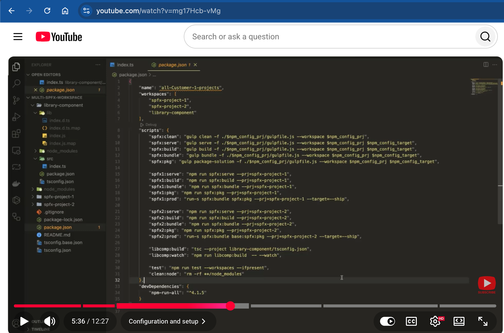
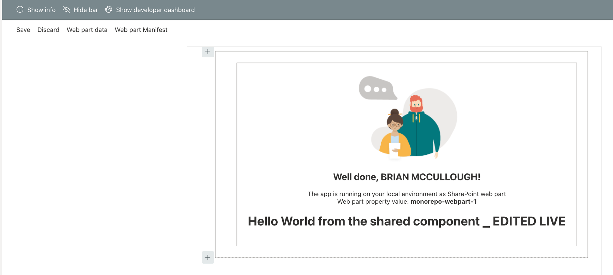
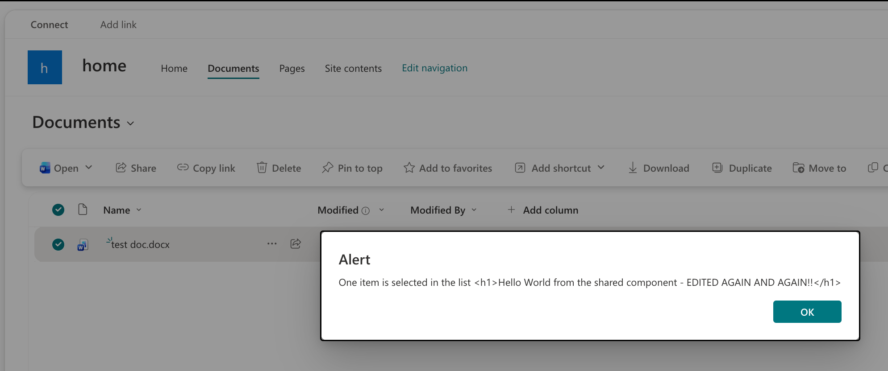
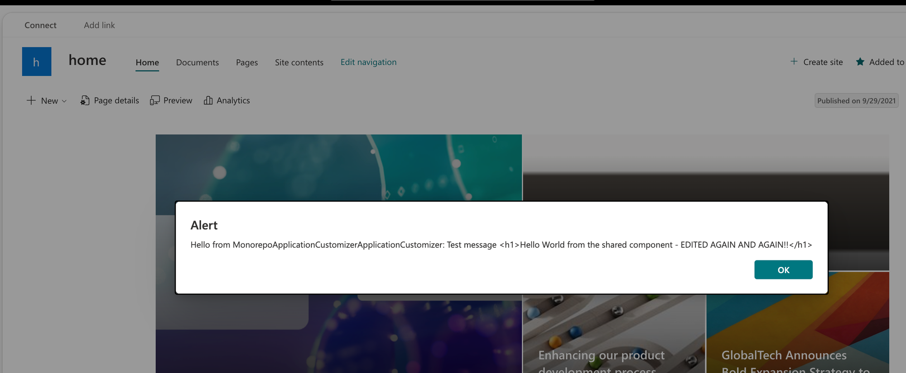

# spfx-mono-repo-npm-workspace

Exploring how to build an SPFx monorepo with multiple SPFx solutions in a single repository using npm workspaces. Goals include simplifying SPFx version upgrades, keeping one shared `node_modules` for disk savings and version consistency, and sharing plain TypeScript code across solutions.

Versions for SPFx, Node.js, and npm are listed in the Tech Stack section of [AGENTS.md](AGENTS.md).

## Workspace Layout

```text
package.json                 # workspace root: workspaces + coordinating scripts
package-lock.json            # single lockfile for every workspace
node_modules/                # single hoisted install shared by every workspace
packages/
  webpart-1/                 # SPFx web part solution
  webpart-2/                 # SPFx web part solution
  application-customizer/    # SPFx application customizer solution
  command-set/               # SPFx list view command set solution
  shared/                    # @spfxmonorepo/shared — plain TypeScript, not SPFx
```

Each SPFx project is an independent solution that produces its own `.sppkg`. SPFx projects never depend on each other. The only cross-project dependency is on `@spfxmonorepo/shared`, which is bundled into each consuming `.sppkg`; there is no separate shared `.sppkg`.

## Quick Start

```sh
npm install                   # one install from the repo root
npm run build                 # build shared, then every SPFx project
npm run webpart-1:start       # serve one SPFx project
```

To edit shared code while an SPFx project is running, use two terminals:

```sh
# terminal 1
npm run shared:watch

# terminal 2
npm run webpart-1:start
```

## Walkthrough: How This Repo Was Built

Each step below matches a commit, so you can read the diff alongside the explanation.

### 1. Create the workspace root

Commit: [`5aacfc0`](https://github.com/brianpmccullough/spfx-mono-repo-npm-workspace/commit/5aacfc0)

The root `package.json` is private and declares every folder under `packages/` as a workspace:

```json
{
  "name": "spfx-mono-repo-npm-workspace",
  "private": true,
  "workspaces": [
    "packages/*"
  ]
}
```

That single `workspaces` entry is what makes `npm install` at the root install every project together, hoist shared dependencies into the root `node_modules`, and symlink each workspace package into it.

### 2. Scaffold the SPFx projects

Commit: [`b96c54b`](https://github.com/brianpmccullough/spfx-mono-repo-npm-workspace/commit/b96c54b)

Each SPFx project is created with the official SharePoint Framework Yeoman generator (`yo @microsoft/sharepoint`) in its own folder under `packages/`: two web parts, an application customizer, and a list view command set.

The generated files are left as-is. Each project keeps its own `package.json`, its own Heft `build`, `clean`, and `start` scripts, and its own `config/` folder. Dependencies are installed once from the repo root rather than inside each project, so there are no per-project lockfiles.

### 3. Add a plain TypeScript shared package

Commit: [`36734e1`](https://github.com/brianpmccullough/spfx-mono-repo-npm-workspace/commit/36734e1)

`packages/shared` is a normal TypeScript package, not an SPFx library component. It compiles with plain `tsc` from `src/` to `lib/`:

```json
{
  "compilerOptions": {
    "target": "es2020",
    "module": "esnext",
    "moduleResolution": "bundler",
    "lib": ["es2020", "dom"],
    "strict": true,
    "esModuleInterop": true,
    "resolveJsonModule": true,
    "declaration": true,
    "sourceMap": true,
    "skipLibCheck": true,
    "rootDir": "src",
    "outDir": "lib"
  },
  "include": ["src/**/*.ts"],
  "exclude": ["**/*.spec.ts"]
}
```

Why these choices:

- **`target: es2020`** — SPFx's webpack build does not transpile dependencies, so this syntax ships as-is. Every browser SharePoint Online supports runs it.
- **`module: esnext` + `moduleResolution: bundler`** — ES modules let webpack tree-shake, and `bundler` resolves imports the way webpack does without requiring `.js` extensions. Avoid `NodeNext`; it targets code that runs directly in Node.
- **`declaration: true`** — emits `.d.ts` files so SPFx projects get types.
- **`lib` matches `target`** — keep exported types plain so SPFx projects (which use a narrower `lib`) can consume them.

The package's `package.json` points consumers at the compiled output:

```json
"main": "lib/index.js",
"types": "lib/index.d.ts",
"scripts": {
  "build": "tsc",
  "clean": "rm -rf lib"
}
```

### 4. Wire the shared package into each SPFx project

Commit: [`591ffa1`](https://github.com/brianpmccullough/spfx-mono-repo-npm-workspace/commit/591ffa1)

- Rename the package to a scoped, private name so it can never be confused with (or published to) the public npm registry:

  ```json
  "name": "@spfxmonorepo/shared",
  "private": true
  ```

- Add it to the `dependencies` of every SPFx project. `*` matches the local workspace version, so npm links `packages/shared` instead of downloading anything:

  ```json
  "@spfxmonorepo/shared": "*"
  ```

- Run `npm install` from the root. This creates the single root `package-lock.json` and the symlink `node_modules/@spfxmonorepo/shared -> packages/shared`.

### 5. Add root scripts for each project

Commit: [`3c4502c`](https://github.com/brianpmccullough/spfx-mono-repo-npm-workspace/commit/3c4502c)

Root scripts delegate to each workspace's own scripts with `npm run <script> -w <workspace>`, so nothing is duplicated and changes to a project's scripts are picked up automatically. `build` and `start` compile `shared` first because SPFx can't resolve the import until `shared/lib` exists.

```json
"shared:build": "npm run build -w @spfxmonorepo/shared",
"shared:watch": "npm run build -w @spfxmonorepo/shared -- --watch",
"webpart-1:build": "npm run shared:build && npm run build -w webpart-1",
"webpart-1:clean": "npm run clean -w webpart-1",
"webpart-1:start": "npm run shared:build && npm run start -w webpart-1",
"clean:node": "rm -rf node_modules packages/*/node_modules"
```

The same `build`, `clean`, and `start` trio exists for `webpart-2`, `application-customizer`, and `command-set`. The root `build` and `clean` scripts run across every workspace. There is no "start all", because each `heft start` uses the same local dev server port.

This approach is based on [@stfbauer](https://github.com/stfbauer)'s [video walkthrough of an SPFx npm workspace](https://www.youtube.com/watch?v=mg17Hcb-vMg) — credit to him for the per-project root script pattern. His setup uses gulp; its per-project `serve`, `bundle`, `pkg`, and `prod` scripts aren't needed with Heft: each project's `build` already tests, bundles, and packages the `.sppkg` in production mode, and `start` replaces `serve`.



_Screenshot from [@stfbauer](https://github.com/stfbauer)'s [video](https://www.youtube.com/watch?v=mg17Hcb-vMg)._

> **Note:** npm runs scripts with `sh`, where `**` matches only one folder level. That's why `clean:node` lists `node_modules` and `packages/*/node_modules` explicitly instead of using `**/node_modules`.

### 6. Resolve the SPFx build rig from the hoisted `node_modules`

Commit: [`77b9b73`](https://github.com/brianpmccullough/spfx-mono-repo-npm-workspace/commit/77b9b73)

The generator assumes each project has its own full `node_modules`. In a workspace, `@microsoft/spfx-web-build-rig` is hoisted to the root, so the generated `tsconfig.json` fails with:

```text
file referenced in "extends" property
("./node_modules/@microsoft/spfx-web-build-rig/profiles/default/tsconfig-base.json") cannot be resolved.
```

Pointing `extends` at the root copy isn't enough on its own: the rig's base config locates `src` and `lib` with paths like `../../../../../src`, counted from its own install location. From the root `node_modules`, those land on the repo root instead of the project.

The fix, applied to every SPFx project's `tsconfig.json`, extends the rig by package name and sets the project-relative paths explicitly:

```json
{
  "extends": "@microsoft/spfx-web-build-rig/profiles/default/tsconfig-base.json",
  "compilerOptions": {
    "outDir": "lib",
    "rootDir": "src",
    "rootDirs": ["src", "temp/loc-ts", "temp/sass-ts", "temp/static-asset-ts"],
    "typeRoots": ["./node_modules/@types", "../../node_modules/@types"]
  },
  "include": ["src/**/*.ts", "src/**/*.tsx"]
}
```

No other SPFx config needed changing: `config/rig.json` already finds the rig by package name.

An alternative is `install-strategy=nested` in `.npmrc`, which gives each project its own full `node_modules` and leaves generated files untouched. It's rejected here because it defeats a main goal of the monorepo: one shared `node_modules` for disk savings and version consistency.

### 7. Use the shared package in every SPFx project

Commits: [`abf37c6`](https://github.com/brianpmccullough/spfx-mono-repo-npm-workspace/commit/abf37c6), [`2c55e74`](https://github.com/brianpmccullough/spfx-mono-repo-npm-workspace/commit/2c55e74)

Every project imports the same export:

```ts
import { helloWorld } from '@spfxmonorepo/shared';
```

The web parts render it as HTML:

```tsx
<div dangerouslySetInnerHTML={{ __html: helloWorld }} />
```

`helloWorld` is a constant from our own package, not user input, so `dangerouslySetInnerHTML` is safe here.

With `shared:watch` running alongside `webpart-1:start`, editing `packages/shared/src/index.ts` recompiles `shared/lib` and the web part rebuilds automatically. webpack follows the `node_modules` symlink to the real files in `packages/shared/lib` and watches them like local source.



The extensions append it to their existing `Dialog.alert` messages. `Dialog.alert` shows plain text, so the `<h1>` tags appear literally and the line breaks are dropped:





Exporting plain text (or data) from `shared` instead of HTML strings would be cleaner for the extensions.

## Resources and References

- [Use SharePoint Framework with npm/yarn workspaces](https://n8d.at/use-sharepoint-framework-with-npm-yarn-work-spaces)
- [How to manage multiple SPFx solutions efficiently](https://pnp.github.io/blog/post/how-to-manage-multiple-spfx-solutions-efficiently)
- [SPFx npm workspace video walkthrough](https://www.youtube.com/watch?v=mg17Hcb-vMg) by [@stfbauer](https://github.com/stfbauer) — the source of this repo's root script pattern
